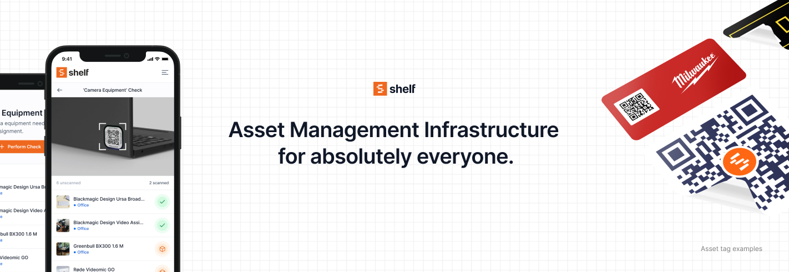
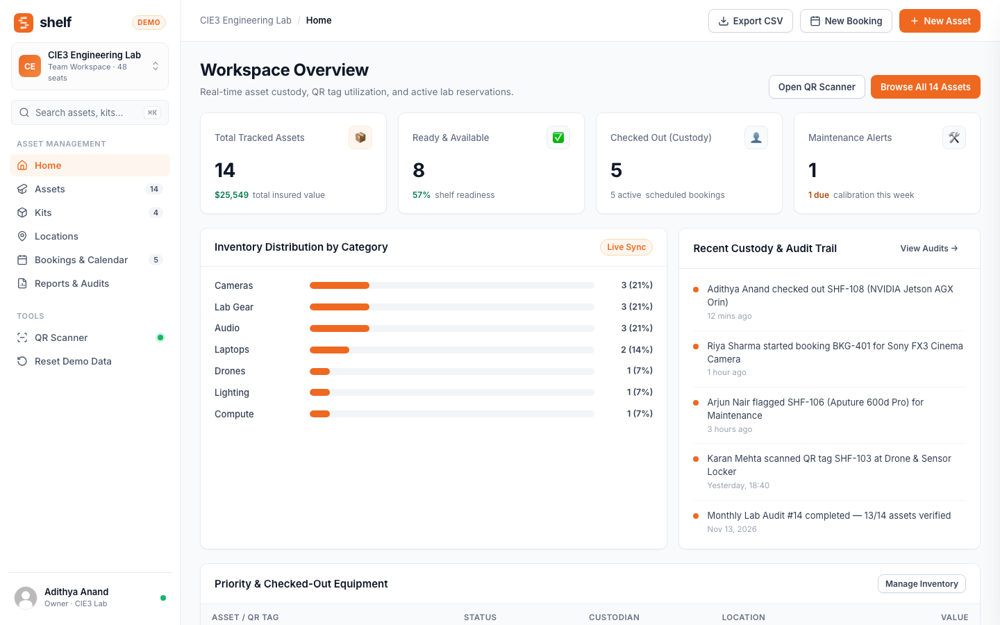
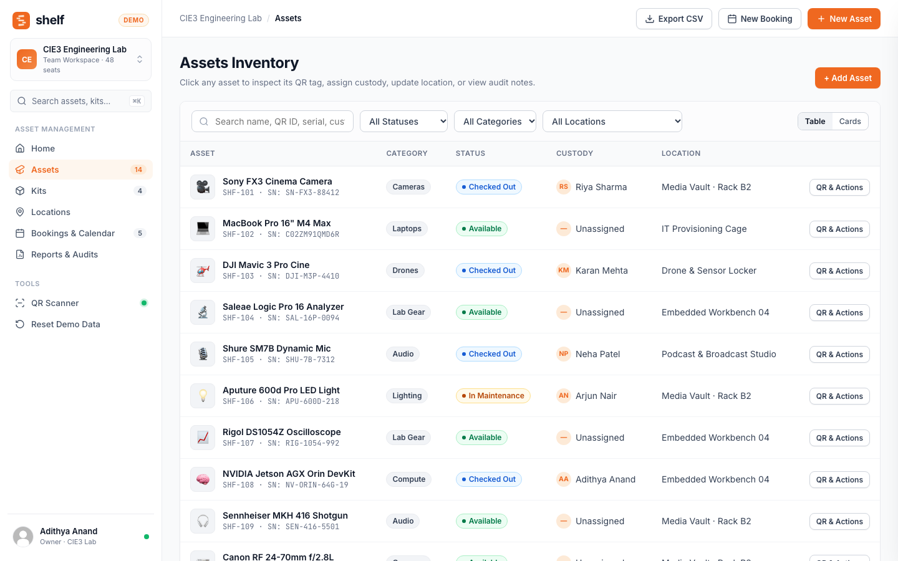
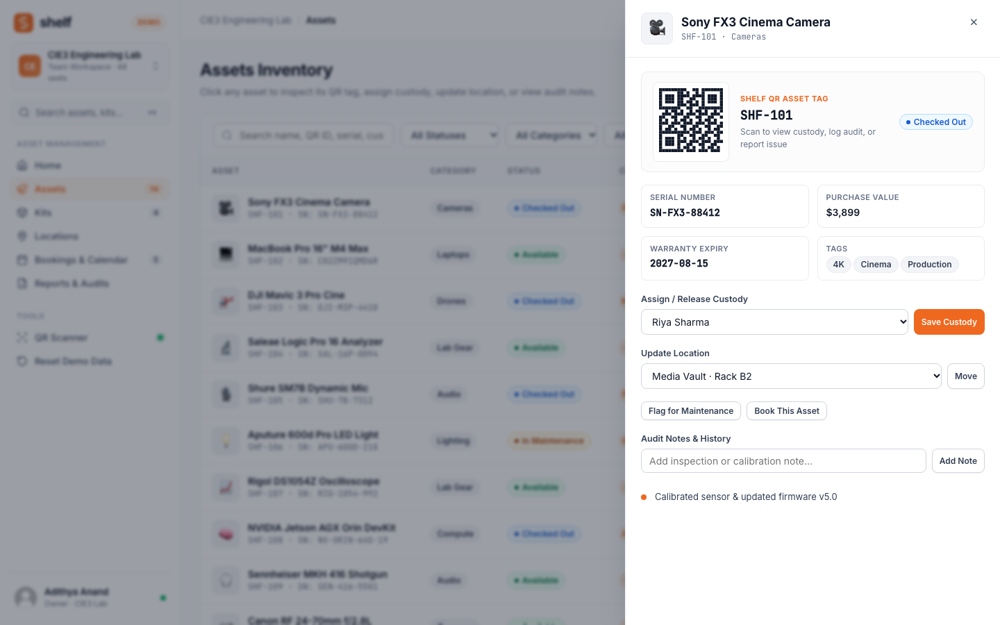
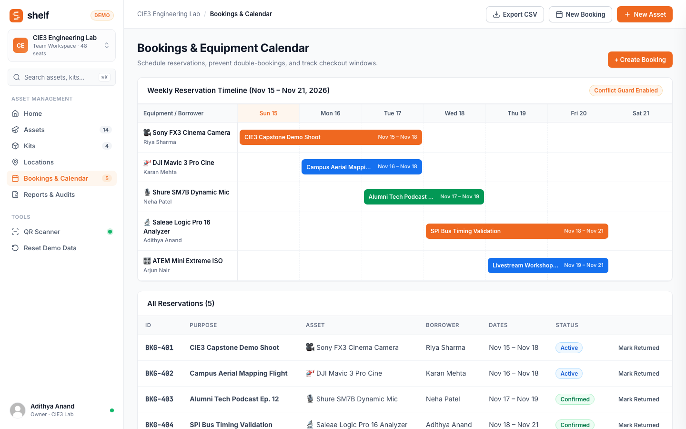
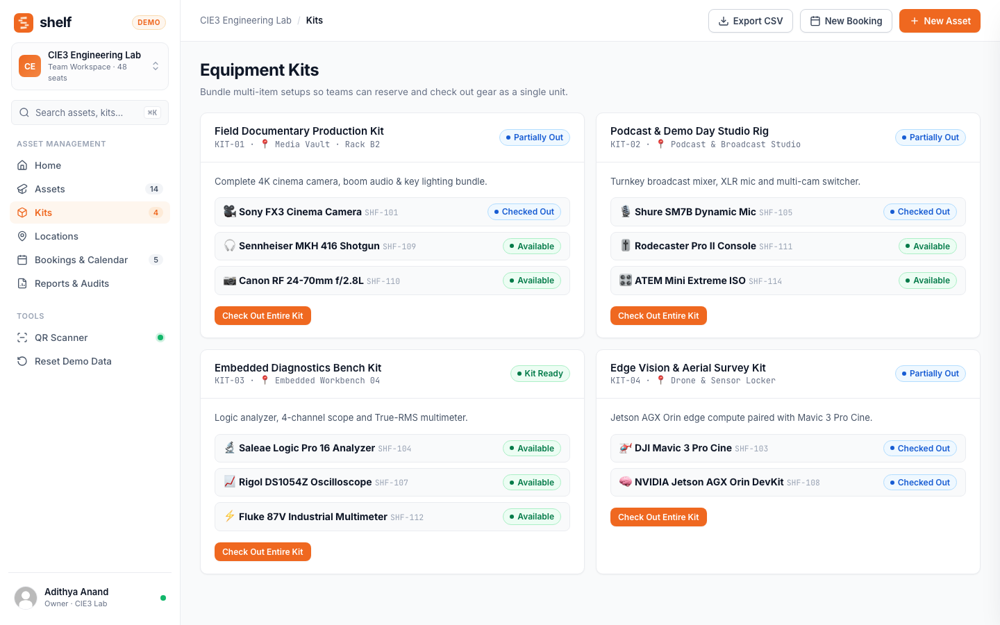
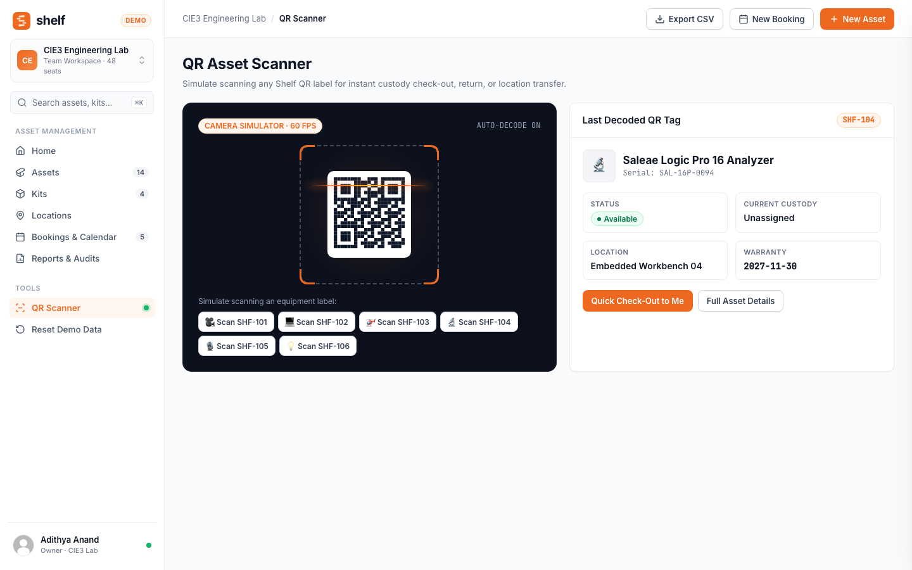

<a href="https://www.shelf.nu/" target="_blank">

</a>

<h2 align="center">CIE3 Elective Project — Shelf.nu Asset Management &amp; Interactive UI Demo</h2>

<p align="center">
  <b>Open-source asset management infrastructure</b> with a <b>zero-backend interactive UI prototype &amp; mock workspace</b> (<a href="./demo/index.html"><code>demo/index.html</code></a>) showcasing exact screens, QR asset tagging, custody workflows, bookings calendar, kits, and live scanner simulation.
</p>

<p align="center">
  <a href="https://github.com/Shelf-nu/shelf.nu/blob/main/LICENSE"></a>
  <a href="./demo/index.html"></a>
  <a href="https://github.com/Shelf-nu/shelf.nu/actions/workflows/deploy.yml"></a>
</p>

---

## Interactive UI Mock &amp; Demo Preview (`demo/`)

Want to test the complete UI immediately without configuring PostgreSQL or Supabase? Open the self-contained interactive demo in any browser:

```bash
# Option 1: Serve locally
npx serve demo
# or with Python:
python3 -m http.server 3000 --directory demo
```

Then open `http://localhost:3000` (or open `demo/index.html` directly). All changes persist in `localStorage`, and you can click **Reset Demo Data** anytime in the sidebar.

### Working Demo Capabilities
- **Workspace Overview:** Live KPI cards (insured value, readiness %, active custody, maintenance alerts), category distribution bars, and real-time audit trail.
- **Assets Inventory (`Table` &amp; `Cards` views):** Search by name/QR tag/serial, filter by status, category, or location, and create new assets with auto-generated QR tags.
- **Asset Detail Slide-Over &amp; QR Tagging:** Deterministic SVG QR asset tags, 1-click custody check-out/release, location transfers, maintenance flags, and audit notes.
- **Bookings &amp; Weekly Calendar:** Visual 7-day equipment reservation timeline with conflict guard, booking creation modal, and return completion.
- **Equipment Kits &amp; Locations Hierarchy:** Bundle multi-item kits for 1-click checkout and drill down by building/floor/rack.
- **Interactive QR Scanner Simulator &amp; `⌘K` Command Palette:** Simulate scanning equipment labels for instant check-out/return, plus real **CSV Export**.

---

## Exact UI Demo Screenshots

### 1. Workspace Overview &amp; Live Custody Feed


### 2. Assets Inventory (Search, Multi-Filter &amp; Status Tracking)


### 3. Asset Detail Drawer, Live QR Tag &amp; Custody Controls


### 4. Bookings &amp; Equipment Reservation Calendar


### 5. Equipment Kits &amp; Bundle Checkout


### 6. Interactive QR Asset Scanner Simulator


---

Shelf is a platform for tracking physical assets — equipment, devices, tools, vehicles, props, inventory. It's built for teams that need to know what they have, where it is, and who's using it. Organizations use Shelf to manage thousands of assets across locations with role-based access for their teams.

## Features

- **QR asset tags** — Generate and print QR codes. Scan with any phone to view, check out, or report an asset.
- **Bookings and reservations** — Schedule equipment, prevent double-bookings, set checkout/return dates with calendar integration.
- **Custody tracking** — Assign assets to team members. Know who has what at all times.
- **Location management** — Hierarchical locations (buildings, floors, rooms, shelves). GPS tagging support.
- **Team roles** — Owner, Admin, Base, and Self Service roles with granular permissions.
- **Custom fields** — Add any metadata to assets: purchase date, warranty info, serial numbers, condition.
- **Categories and tags** — Organize assets into categories. Tag for flexible cross-cutting grouping.
- **Kits** — Bundle assets into kits (e.g., laptop + charger + dock) and manage them as a unit.
- **Search and filtering** — Full-text search with advanced filters. Saved filter presets.
- **CSV import/export** — Bulk import assets from spreadsheets. Export for reporting.
- **Asset reminders** — Schedule alerts for maintenance, calibration, warranty expiry.
- **Audit trail** — Notes and activity logs on every asset.
- **Multi-workspace** — Manage separate inventories for different organizations or departments.
- **Scanner** — Built-in QR/barcode scanner with bulk actions: assign custody, update location, add to bookings.

## Tech Stack

| Layer      | Technology                                                                      |
| ---------- | ------------------------------------------------------------------------------- |
| Framework  | [React Router](https://reactrouter.com/) 7 (React 19)                           |
| Language   | [TypeScript](https://www.typescriptlang.org/) 5                                 |
| Database   | [PostgreSQL](https://www.postgresql.org/) via [Supabase](https://supabase.com/) |
| ORM        | [Prisma](https://www.prisma.io/) 6                                              |
| Styling    | [Tailwind CSS](https://tailwindcss.com/) 3                                      |
| Components | [Radix UI](https://www.radix-ui.com/) primitives                                |
| Auth       | [Supabase Auth](https://supabase.com/docs/guides/auth) (email, SSO)             |
| Job queue  | [pg-boss](https://github.com/timgit/pg-boss)                                    |
| Payments   | [Stripe](https://stripe.com/)                                                   |
| Email      | [Nodemailer](https://nodemailer.com/) (SMTP)                                    |
| Build      | [Vite](https://vite.dev/) 7, [Turborepo](https://turbo.build/)                  |
| Testing    | [Vitest](https://vitest.dev/), [Playwright](https://playwright.dev/)            |

## Getting Started

### Prerequisites

- [Node.js](https://nodejs.org/) >= 24.22.1
- [pnpm](https://pnpm.io/) >= 9.15.4
- A [Supabase](https://supabase.com/) project (free tier works)

### Setup

```bash
# Clone the repository
git clone https://github.com/Shelf-nu/shelf.nu.git
cd shelf.nu

# Install dependencies
pnpm install

# Copy environment template
cp .env.example .env
```

Edit `.env` with your Supabase credentials and other configuration. See the [Supabase setup guide](https://docs.shelf.nu/supabase-setup) for step-by-step instructions.

```bash
# Generate Prisma client and run migrations
pnpm webapp:setup

# Start development server
pnpm webapp:dev
```

The app runs at `https://localhost:3000` (the dev server uses HTTPS with local certificates by default).

For detailed setup instructions including SSL certificates and troubleshooting, see the [local development guide](https://docs.shelf.nu/local-development).

## Project Structure

```
shelf.nu/
├── apps/
│   ├── webapp/          # Main application (React Router + Hono)
│   │   ├── app/
│   │   │   ├── routes/      # File-based routing
│   │   │   ├── modules/     # Business logic (booking, asset, kit, etc.)
│   │   │   ├── components/  # React components
│   │   │   └── utils/       # Shared utilities
│   │   └── public/          # Static assets
│   └── docs/            # Documentation site (VitePress)
├── packages/
│   └── database/        # Prisma schema, migrations, client
└── tooling/
    └── typescript/      # Shared TypeScript config
```

The monorepo is managed with pnpm workspaces and Turborepo. The `@shelf/database` package owns all database concerns — schema, migrations, and Prisma client generation.

## Commands

| Command                     | Description                             |
| --------------------------- | --------------------------------------- |
| `pnpm webapp:dev`           | Start development server                |
| `pnpm webapp:build`         | Production build                        |
| `pnpm webapp:test`          | Run tests (Vitest)                      |
| `pnpm webapp:validate`      | Lint + typecheck + test                 |
| `pnpm webapp:doctor`        | React health scan (react-doctor)        |
| `pnpm companion:doctor`     | React Native health scan (react-doctor) |
| `pnpm webapp:setup`         | Generate Prisma client + run migrations |
| `pnpm db:prepare-migration` | Create a new database migration         |
| `pnpm db:deploy-migration`  | Apply pending migrations                |
| `pnpm db:reset`             | Reset database (destructive)            |
| `pnpm docs:dev`             | Start documentation site                |
| `pnpm typecheck`            | TypeScript type checking                |
| `pnpm lint`                 | ESLint                                  |

## Deployment

### Fly.io

Shelf deploys to [Fly.io](https://fly.io/) with GitHub Actions for CI/CD. Pushes to `dev` trigger staging deploys and pushes to `main` trigger production deploys; in both cases we run lint, typecheck, test, Docker build, and deploy.

See the [deployment guide](https://docs.shelf.nu/deployment) for full setup instructions.

### Docker

Community-maintained Docker support is available for self-hosting. Requires an external Supabase instance.

See the [Docker guide](https://docs.shelf.nu/docker).

## Documentation

| Guide                                                        | Description                                  |
| ------------------------------------------------------------ | -------------------------------------------- |
| [Local Development](https://docs.shelf.nu/local-development) | Full local setup with SSL, monorepo overview |
| [Supabase Setup](https://docs.shelf.nu/supabase-setup)       | Database, auth, storage configuration        |
| [Deployment](https://docs.shelf.nu/deployment)               | Fly.io + GitHub Actions CI/CD                |
| [Docker](https://docs.shelf.nu/docker)                       | Self-hosted Docker setup                     |
| [App Configuration](https://docs.shelf.nu/app-configuration) | `shelf.config.ts` options                    |
| [Error Handling](https://docs.shelf.nu/handling-errors)      | Error patterns and conventions               |
| [Accessibility](https://docs.shelf.nu/accessibility)         | WCAG 2.1 AA compliance                       |
| [Contributing](./CONTRIBUTING.md)                            | How to contribute                            |

For developer onboarding and codebase conventions, see [`CLAUDE.md`](./CLAUDE.md).

## Contributing

We welcome contributions. Check the [contribution guidelines](./CONTRIBUTING.md) and look for issues labeled [**"Open for contributions"**](https://github.com/Shelf-nu/shelf.nu/issues?q=is%3Aissue+is%3Aopen+label%3A%22Open+for+contributions%22).

The project uses [conventional commits](https://www.conventionalcommits.org/), enforced by commitlint. Pre-commit hooks run ESLint, Prettier, and TypeScript checking via Lefthook.

Join the [Discord](https://discord.gg/8he9W7aTJu) if you have questions or want to discuss your contribution.

## License

Shelf.nu is licensed under [AGPL-3.0](./LICENSE), with one exception.

The companion mobile app in [`apps/companion/`](./apps/companion) is **not open source**. Its source is available under the [PolyForm Internal Use License 1.0.0](./apps/companion/LICENSE). You may read it, build it and change it for the internal business operations of your own company. You may not distribute it. Publishing the app, or an app based on it, on the Apple App Store, Google Play or any other store is distribution.

This section is a summary. The license files are the binding terms.
